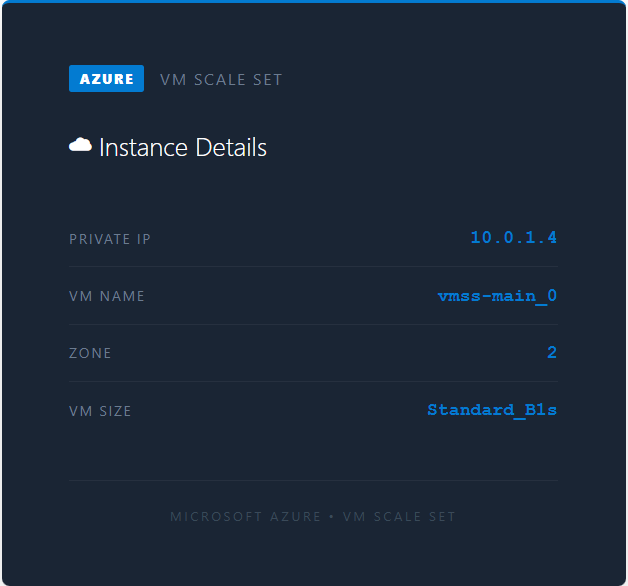

# Azure VM Scale Set behind an Application Gateway

A minimal **Azure Virtual Machine Scale Set** built with Terraform. Apache
web servers run on private Ubuntu 24.04 instances behind an **Application
Gateway**, and each one serves a page with its own instance metadata
(private IP, VM name, zone and size) from the Azure Instance Metadata
Service. **Azure Monitor autoscale** grows and shrinks the set on CPU.
There's no Packer and no custom image: one Terraform phase does it all.



| Piece | Where | Role |
|---|---|---|
| **vmss-appgw** | `appgw-subnet` (`10.0.2.0/24`) | Application Gateway Standard_v2, capacity 1, zones 1 and 2; HTTP listener on 80; per-request routing to the backend pool with no cookie affinity; health probe on `/` every 10 seconds |
| **vmss-appgw-pip** | public IP | Standard static, zones 1 and 2; DNS label `vmss-appgw-<10000-99999>.centralus.cloudapp.azure.com` |
| **vmss-main** | `vmss-subnet` (`10.0.1.0/24`) | Ubuntu 24.04, `Standard_B1s`, StandardSSD; 4 instances to start, zones 1 and 2; no public IPs; manual upgrade mode; `custom_data.sh` installs Apache and jq and writes the metadata page and `/plain` (just the private IP) |
| **vmss-autoscale** | Azure Monitor | 1 to 6 instances, default 4; see [Scaling](#scaling) |
| **vmss-nat** | `vmss-subnet` | NAT gateway with `vmss-nat-pip`; the subnet's default outbound access is off, so this is the only way out |
| **vmss-nsg** | `vmss-subnet` | HTTP (80) in |
| **appgw-nsg** | `appgw-subnet` | `GatewayManager` on 65200-65535 (Azure requires it) and HTTP (80) in |
| **vmss-vnet** | `vmss-rg`, `centralus` | `10.0.0.0/16` |

## Architecture

<picture>
  <source media="(prefers-color-scheme: dark)" srcset="architecture-dark.svg">
  
</picture>

Regenerate with `python3 make_diagram.py`.

Everything is in **`01-vmss/`**: `appgw.tf`, `vmss.tf` (scale set and
autoscale), `networking.tf` (VNet, subnets, NAT gateway), `security.tf`
(NSGs) and `scripts/custom_data.sh`.

## Scaling

| Rule | Condition | Window | Action | Cooldown |
|---|---|---|---|---|
| scale out | average CPU > 60% | 2 minutes | +1 instance | 2 minutes |
| scale in | average CPU < 60% | 1 hour | -1 instance | 2 minutes |

The hour-long scale-in window keeps instances from disappearing during a
demo or a short quiet spell. The scale set ignores changes to its instance
count in Terraform, so a later `apply` doesn't undo what autoscale did.

## Prerequisites

* [An Azure Account](https://portal.azure.com/)
* [Install Azure CLI](https://learn.microsoft.com/en-us/cli/azure/install-azure-cli)
* [Install Terraform](https://developer.hashicorp.com/terraform/install)

Sign in first:

```bash
az login
az account set --subscription "<your-subscription-id>"
```

If this is your first time watching our content, we recommend starting with
this video: [Azure + Terraform: Easy Setup](https://www.youtube.com/watch?v=j4aRjgH5H8Q).

## Deploy

```bash
git clone https://github.com/mamonaco1973/azure-vmss.git
cd azure-vmss
./apply.sh
```

`apply.sh` runs `check_env.sh`, applies `01-vmss` (the Application Gateway
takes 5 to 8 minutes) and runs `validate.sh`. That waits for the gateway to
return HTTP 200 on `/plain`, samples ten responses to show the load
balancing, and reports how long the deploy took to serve its first request:

```
NOTE: App Gateway endpoint: http://vmss-appgw-12345.centralus.cloudapp.azure.com
NOTE: Waiting for HTTP response from Application Gateway...
NOTE: Application Gateway is responding.
NOTE: Sampling App Gateway responses...

  [1] 10.0.1.4
  [2] 10.0.1.6
  [3] 10.0.1.5
  [4] 10.0.1.7
  ...

=================================================================================
  VM Scale Set — Deployment validated!
=================================================================================
  LB : http://vmss-appgw-12345.centralus.cloudapp.azure.com
---------------------------------------------------------------------------------
  Time to first request : 512s
```

## Try it

1. Open the endpoint in a browser and refresh: the private IP, VM name and
   zone change from request to request.
2. Instances have no SSH access. Use Run Command, which goes through the
   Azure agent rather than the network:

   ```bash
   az vmss list-instances -g vmss-rg -n vmss-main \
     --query "[].{id:instanceId, name:name}" -o table

   az vmss run-command invoke -g vmss-rg -n vmss-main --instance-id 0 \
     --command-id RunShellScript \
     --scripts "cat /root/userdata.log" \
     --query "value[0].message" -o tsv
   ```

3. To watch it scale out, load an instance's CPU the same way (for
   example `--scripts "timeout 600 yes > /dev/null &"`) and watch the
   instance count in the portal.

## Teardown

```bash
./destroy.sh
```

`destroy.sh` destroys `01-vmss`. The provider is set to delete the resource
group even if it still contains resources.

## Notes

- **Lab only.** HTTP only, and the gateway accepts it from anywhere.
- The SSH key is generated by Terraform and never written out, so the
  instances really are Run Command only.
- In the portal, an instance's overview shows the NAT gateway's public IP;
  the instances themselves have none.
- The old README linked the AWS setup video under the Azure title; it now
  links the Azure one.
